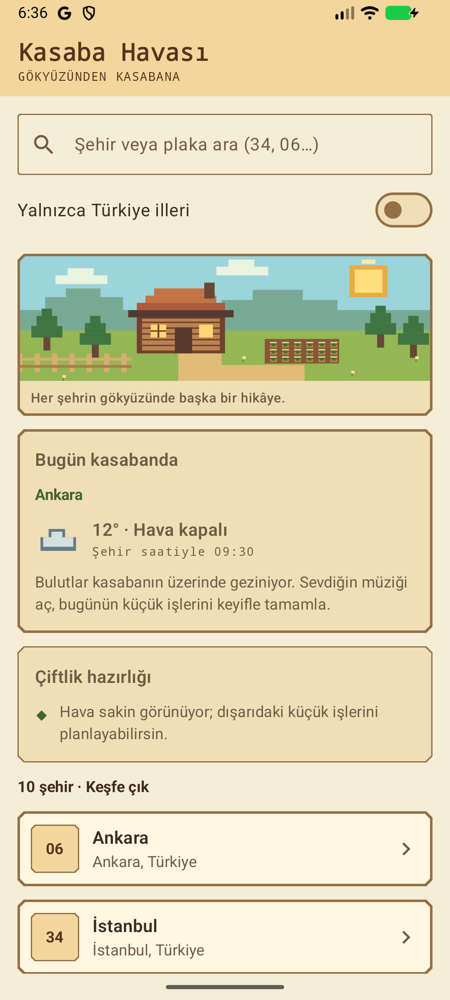
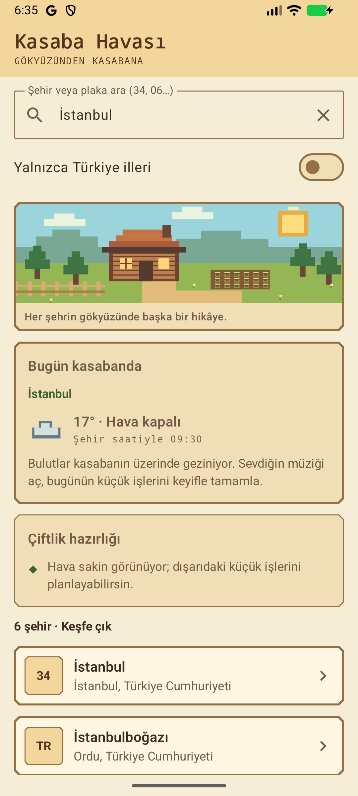
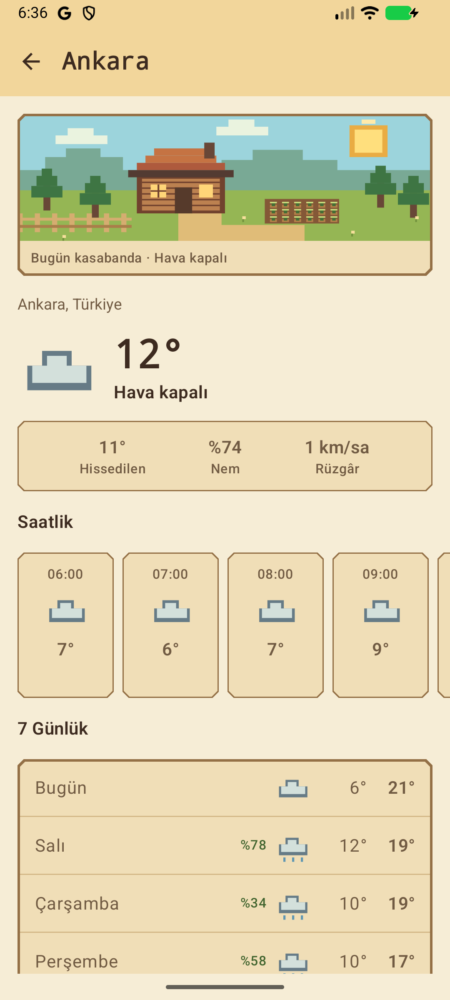

# 🌤️ Kasaba Havası

**Gökyüzünden kasabana.**

Kasaba Havası, hava durumunu çiftlik oyunlarından esinlenen piksel temalı bir arayüzle sunan Android uygulamasıdır. Şehrini adıyla veya plaka koduyla bulabilir, güncel hava durumunu ve önümüzdeki 7 günün tahminini takip edebilirsin. Hava koşullarına göre değişen kasaba manzarası ve günlük öneriler, deneyime sıcak bir kasaba atmosferi katar.

## Ekran görüntüleri

<table>
  <tr>
    <th>Kasaba ve günlük</th>
    <th>Şehir araması</th>
    <th>Hava tahmini</th>
  </tr>
  <tr>
    <td></td>
    <td></td>
    <td></td>
  </tr>
</table>

Görseller uygulamanın Android emülatöründe çalışan sürümünden alınmıştır.

## Özellikler

- **Şehir ve plaka araması:** Dünya şehirlerini isimle, Türkiye'nin 81 ilini `34`, `06` veya `6` gibi plaka kodlarıyla ara.
- **Türkiye filtresi:** Sonuçları yalnızca Türkiye illeriyle sınırla.
- **Hızlı başlangıç:** Arama boşken plaka rozetleriyle sunulan 10 şehirden birini seç.
- **Güncel hava durumu:** Sıcaklık, hissedilen sıcaklık, nem ve rüzgâr bilgilerini görüntüle.
- **Saatlik ve 7 günlük tahmin:** Sıcaklık değişimlerini, hava koşullarını ve yağış olasılığını incele.
- **Yaşayan kasaba teması:** Hava durumuna göre değişen piksel manzarasını keşfet.
- **Kasaba günlüğü:** “Bugün kasabanda” ve “Çiftlik hazırlığı” alanlarında hava koşullarına uygun günlük önerileri oku.
- **Akıcı arama:** Yazarken kısa bir bekleme sonrası güncellenen sonuçlar, aramayı temizleme ve klavyeden arama desteği.
- **Açık ve koyu tema:** Sistem görünümüne uyum sağlayan renkler.
- **Durum yönetimi:** Yükleme animasyonları, boş sonuç açıklamaları ve hata sonrası tekrar deneme.

Şehir ve hava tahmini verileri Open-Meteo servislerinden alınır. Mevcut servis entegrasyonu API anahtarı gerektirmez; güncel verilerin alınması için internet bağlantısı gerekir.

## Kullanım

1. Uygulamayı açıp bir şehir adı veya Türkiye plaka kodu yaz.
2. İstersen **Yalnızca Türkiye illeri** filtresini etkinleştir.
3. Şehir kartına dokunarak ayrıntılı hava tahminine geç.
4. Anlık verileri, saatlik tahmini ve 7 günlük görünümü incele.

## Kullanılan teknolojiler

| Alan | Teknolojiler |
| --- | --- |
| Dil | Kotlin |
| Arayüz | Jetpack Compose, Material 3 |
| Ekranlar arası geçiş | Navigation Compose |
| Durum yönetimi | ViewModel, StateFlow, SavedStateHandle |
| Asenkron işlemler | Kotlin Coroutines |
| Ağ ve JSON | Retrofit, Gson |
| Test | JUnit, Coroutines Test, MockWebServer |
| Derleme ve kod biçimi | Gradle Kotlin DSL, Spotless, ktlint |

## Kurulum ve çalıştırma

### Gereksinimler

- Android Studio
- JDK 17
- Android SDK 36
- Android 8.0 (API 26) veya üzeri bir cihaz ya da emülatör

### Android Studio ile

1. Bu depoyu bilgisayarına klonla veya ZIP olarak indirip aç.
2. Android Studio'da proje kök klasörünü aç.
3. SDK konumunu yapılandır ve Gradle eşitlemesinin tamamlanmasını bekle.
4. Cihazını veya emülatörünü seçip **Run** ile uygulamayı başlat.

SDK konumu gerektiğinde proje kökündeki `local.properties` dosyasına `sdk.dir=...` olarak tanımlanabilir. Bu dosya bilgisayara özeldir ve Git'e dahil edilmez.

### Komut satırı ile

Windows / PowerShell:

```powershell
.\gradlew.bat assembleDebug
```

macOS / Linux:

```bash
chmod +x gradlew
./gradlew assembleDebug
```

Oluşan APK: `app/build/outputs/apk/debug/app-debug.apk`.

### Test ve kontroller

```powershell
.\gradlew.bat testDebugUnitTest lintDebug
.\gradlew.bat spotlessCheck
```

Testler; şehir araması, API yanıtları, ViewModel durumları, plaka eşleştirmeleri, hava kodları ve günlük öneri mantığını kapsar.

### Release derlemesi

```powershell
.\gradlew.bat assembleRelease
```

Kendi imza anahtarını kullanmak için `keystore.properties.example` dosyasını örnek alarak `keystore.properties` oluştur. Mevcut yapılandırma, bu dosya bulunmadığında release derlemesini debug anahtarıyla imzalar. Mağazada dağıtım için kendi release anahtarını yapılandırmalısın. İmza dosyaları ve parolalar depoya eklenmemelidir.

## Proje yapısı

```text
app/src/main/java/com/kampplus/hava/
├── data/          # API servisleri, repository'ler ve şehir verileri
├── model/         # Şehir, tahmin, hava koşulları ve günlük öneri modelleri
├── ui/
│   ├── city/      # Şehir araması ve kasaba görünümü
│   ├── forecast/  # Ayrıntılı hava tahmini
│   ├── component/ # Ortak bileşenler ve piksel çizimleri
│   └── theme/     # Renkler, tipografi ve tema
└── MainActivity.kt
```

Veri akışı: **Compose ekranı → ViewModel → Repository → API**.

Mimari ayrıntılar için [Mimari](docs/ARCHITECTURE.md), görsel tasarım notları için [Kasaba Teması](docs/KASABA-THEME.md) belgelerine bakabilirsin.

## Projenin çıkış noktası

Bu uygulama, Kotlin ve Jetpack Compose öğrenimi kapsamında [weather-app eğitim projesi](https://github.com/tc-yusufburakdemir/weather-app) temel alınarak geliştirilmiştir. Kasaba Havası sürümünde piksel temalı kasaba arayüzü, plaka ile arama, Türkiye illeri filtresi, hava durumuna bağlı günlük ve hazırlık önerileri gibi geliştirmeler yer alır.
